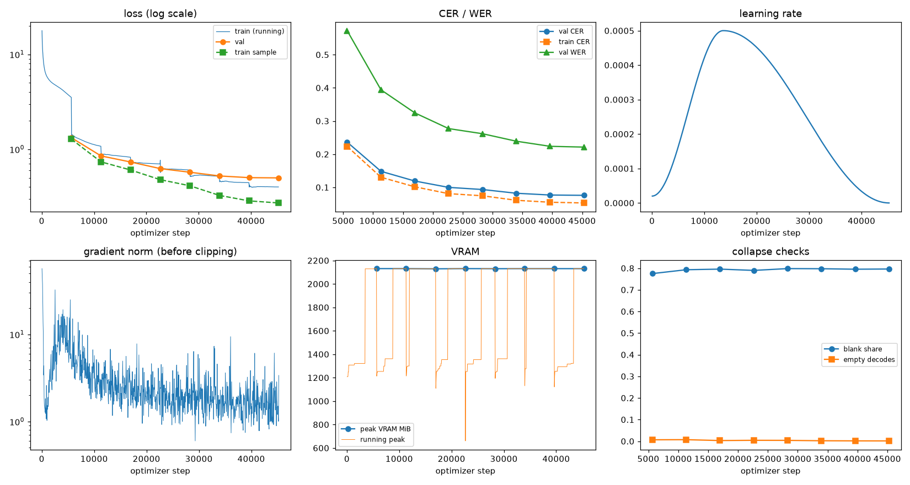
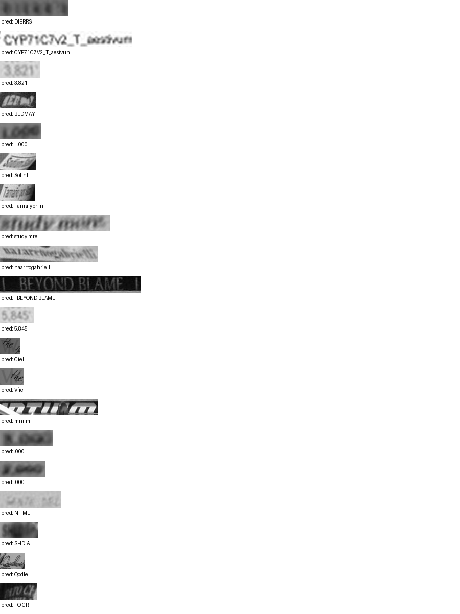

# Run report: GW-REC-027

Generated by `glypharis.training.report`; do not edit by hand.

## Run

- Config hash `36d42ea4e55036a0`, git `fad34c92d684fbbad93391bc88c6c95a2494a70c` (dirty: False)
- Device cuda (NVIDIA GeForce RTX 4050 Laptop GPU), precision bf16, torch 2.14.1+cu126
- Parameters 7,928,835 (30.2 MiB of weights and buffers); 348,935 training lines, 73,888 validation lines
- Epochs run 8, optimizer steps 45,297, stopped early: False; training time 5.34 h (5.34 GPU-hours)
- Data: `processed/hiertext/lines_train` 348,935 lines, sha256 b8cfff844ed2; `processed/hiertext/lines_validation` 73,888 lines, sha256 7db3ec6782ea

## Best and final epoch

| | Epoch | Step | Val CER % | Val WER % | Val loss | Train CER % |
|---|---|---|---|---|---|---|
| best (selected) | 7 | 45297 | 7.59 | 22.13 | 0.4983 | 5.29 |
| final | 7 | 45297 | 7.59 | 22.13 | 0.4983 | 5.29 |

The selected checkpoint is `best.pt`: the lowest validation CER (strict track), as the protocol requires (§7); the final epoch is shown for comparison.

Validation CER of the selected checkpoint: 7.59% [7.44, 7.74] (95% bootstrap CI over 73,888 lines).

## Diagnostics

No flags raised.

## Curves

## Worst validation lines

| Key | Reference | Prediction | CER |
|---|---|---|---|
| bde51cd0a0e194b1/p34/l0 | s | DIERRS | 6.00 |
| 1427a2dd12744f8f/p22/l2 | _T_ | CYP71C7V2_T_aesivun | 5.33 |
| 03221b6a82a5a02e/p85/l0 | 3 | 3.821' | 5.00 |
| 634e5932b6e6f347/p32/l0 | E | BEDMAY | 5.00 |
| 75688de8882f42fa/p11/l0 | 1 | L.000 | 5.00 |
| 902b8cf14489c26a/p18/l9 | S | Sotinl | 5.00 |
| 902b8cf14489c26a/p19/l3 | Ta | Tanraiypr in | 5.00 |
| e20fbc5878d56a36/p1/l40 | 5: | study mre | 4.50 |
| 76a7ad3fe918c4ef/p24/l0 | na/ | naarrtogahriell | 4.33 |
| 83265d4ad42b65eb/p21/l0 | \| \| | I BEYOND BLAME  | 4.33 |
| 03221b6a82a5a02e/p86/l0 | 5 | 5.845 | 4.00 |
| 1177e2fd519784db/p0/l3 | W | Ciel | 4.00 |
| 1177e2fd519784db/p14/l5 | W | Vfie | 4.00 |
| 39fd7d18c550a0f2/p23/l0 | m | mniim | 4.00 |
| 75688de8882f42fa/p11/l3 | 3 | .000 | 4.00 |
| 75688de8882f42fa/p11/l4 | 2 | .000 | 4.00 |
| 983a43804c520cc0/p13/l0 | L | NT ML | 4.00 |
| c624328101a5c91b/p9/l4 | S | SHDIA | 4.00 |
| da589d39cc2c3cea/p4/l1 | Q | Qodle | 4.00 |
| dcee27acd6d6883b/p0/l110 | C | TO CR | 4.00 |

