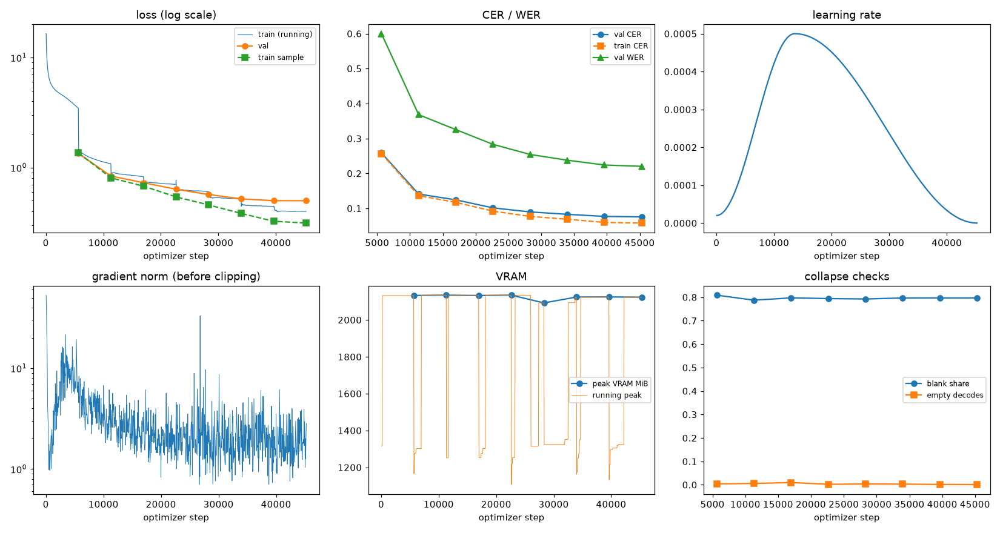
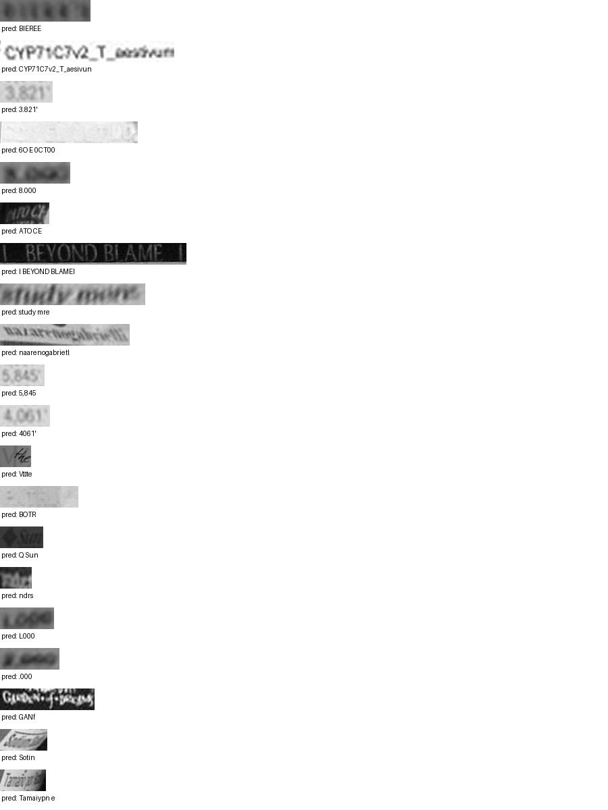

# Run report: GW-REC-028

Generated by `glypharis.training.report`; do not edit by hand.

## Run

- Config hash `940dcc50cf9f32b6`, git `d75e3591a416383859e180d0429df3c8a6b41b96` (dirty: False)
- Device cuda (NVIDIA GeForce RTX 4050 Laptop GPU), precision bf16, torch 2.14.1+cu126
- Parameters 7,928,835 (30.2 MiB of weights and buffers); 348,935 training lines, 73,888 validation lines
- Epochs run 8, optimizer steps 45,298, stopped early: False; training time 5.37 h (5.37 GPU-hours)
- Data: `processed/hiertext/lines_train` 348,935 lines, sha256 b8cfff844ed2; `processed/hiertext/lines_validation` 73,888 lines, sha256 7db3ec6782ea

## Best and final epoch

| | Epoch | Step | Val CER % | Val WER % | Val loss | Train CER % |
|---|---|---|---|---|---|---|
| best (selected) | 7 | 45298 | 7.56 | 22.04 | 0.4994 | 5.80 |
| final | 7 | 45298 | 7.56 | 22.04 | 0.4994 | 5.80 |

The selected checkpoint is `best.pt`: the lowest validation CER (strict track), as the protocol requires (§7); the final epoch is shown for comparison.

Validation CER of the selected checkpoint: 7.56% [7.41, 7.72] (95% bootstrap CI over 73,888 lines).

## Notes

- Resumed from `last.pt` at step 26,000 (epoch 4); 5 log records written after that checkpoint were moved to metrics.dropped.jsonl.
- Resumed from `last.pt` at step 26,000 (epoch 4).

## Diagnostics

No flags raised.

## Curves

## Worst validation lines

| Key | Reference | Prediction | CER |
|---|---|---|---|
| bde51cd0a0e194b1/p34/l0 | s | BIEREE | 6.00 |
| 1427a2dd12744f8f/p22/l2 | _T_ | CYP71C7v2_T_aesivun | 5.33 |
| 03221b6a82a5a02e/p85/l0 | 3 | 3.821' | 5.00 |
| 154058472bd0c3bf/p21/l0 | ND | 6O E 0CT00 | 5.00 |
| 75688de8882f42fa/p11/l3 | 3 | 8.000 | 5.00 |
| dcee27acd6d6883b/p0/l110 | C | ATO CE | 5.00 |
| 83265d4ad42b65eb/p21/l0 | \| \| | I BEYOND BLAMEI | 4.67 |
| e20fbc5878d56a36/p1/l40 | 5: | study mre | 4.50 |
| 76a7ad3fe918c4ef/p24/l0 | na/ | naarenogabrietl | 4.33 |
| 03221b6a82a5a02e/p86/l0 | 5 | 5,845 | 4.00 |
| 03221b6a82a5a02e/p87/l0 | 4 | 4061' | 4.00 |
| 1177e2fd519784db/p14/l5 | W | Víte | 4.00 |
| 154058472bd0c3bf/p47/l0 | P | BOTR | 4.00 |
| 3d874195d3c70081/p15/l0 | S | Q Sun | 4.00 |
| 42207702ddb341c2/p3/l29 | t | ndrs | 4.00 |
| 75688de8882f42fa/p11/l0 | 1 | L000 | 4.00 |
| 75688de8882f42fa/p11/l4 | 2 | .000 | 4.00 |
| 8f80cc3eac928e4e/p21/l0 | C | GANf | 4.00 |
| 902b8cf14489c26a/p18/l9 | S | Sotin  | 4.00 |
| 902b8cf14489c26a/p19/l3 | Ta | Tamaiypn e | 4.00 |

