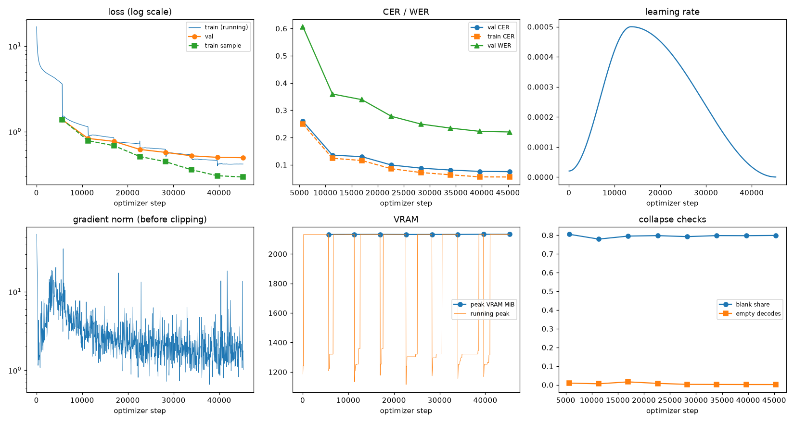
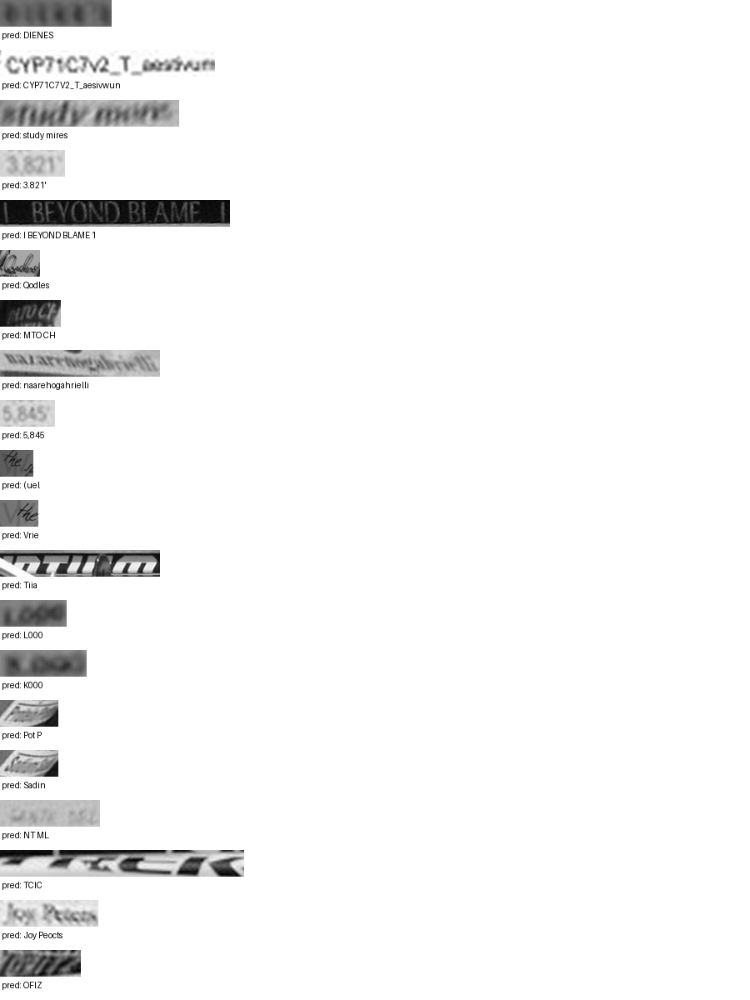

# Run report: GW-REC-029

Generated by `glypharis.training.report`; do not edit by hand.

## Run

- Config hash `5361e68682559021`, git `d75e3591a416383859e180d0429df3c8a6b41b96` (dirty: False)
- Device cuda (NVIDIA GeForce RTX 4050 Laptop GPU), precision bf16, torch 2.14.1+cu126
- Parameters 7,928,835 (30.2 MiB of weights and buffers); 348,935 training lines, 73,888 validation lines
- Epochs run 8, optimizer steps 45,295, stopped early: False; training time 5.05 h (5.05 GPU-hours)
- Data: `processed/hiertext/lines_train` 348,935 lines, sha256 b8cfff844ed2; `processed/hiertext/lines_validation` 73,888 lines, sha256 7db3ec6782ea

## Best and final epoch

| | Epoch | Step | Val CER % | Val WER % | Val loss | Train CER % |
|---|---|---|---|---|---|---|
| best (selected) | 7 | 45295 | 7.48 | 22.05 | 0.4950 | 5.51 |
| final | 7 | 45295 | 7.48 | 22.05 | 0.4950 | 5.51 |

The selected checkpoint is `best.pt`: the lowest validation CER (strict track), as the protocol requires (§7); the final epoch is shown for comparison.

Validation CER of the selected checkpoint: 7.48% [7.34, 7.64] (95% bootstrap CI over 73,888 lines).

## Diagnostics

No flags raised.

## Curves

## Worst validation lines

| Key | Reference | Prediction | CER |
|---|---|---|---|
| bde51cd0a0e194b1/p34/l0 | s | DIENES | 6.00 |
| 1427a2dd12744f8f/p22/l2 | _T_ | CYP71C7V2_T_aesivwun | 5.67 |
| e20fbc5878d56a36/p1/l40 | 5: | study mires | 5.50 |
| 03221b6a82a5a02e/p85/l0 | 3 | 3.821' | 5.00 |
| 83265d4ad42b65eb/p21/l0 | \| \| | I BEYOND BLAME 1 | 5.00 |
| da589d39cc2c3cea/p4/l1 | Q | Qodles | 5.00 |
| dcee27acd6d6883b/p0/l110 | C | MTO CH | 5.00 |
| 76a7ad3fe918c4ef/p24/l0 | na/ | naarehogahrielli | 4.67 |
| 03221b6a82a5a02e/p86/l0 | 5 | 5,845 | 4.00 |
| 1177e2fd519784db/p0/l3 | W | (uel | 4.00 |
| 1177e2fd519784db/p14/l5 | W | Vrie | 4.00 |
| 39fd7d18c550a0f2/p23/l0 | m | Tiia | 4.00 |
| 75688de8882f42fa/p11/l0 | 1 | L000 | 4.00 |
| 75688de8882f42fa/p11/l3 | 3 | K000 | 4.00 |
| 902b8cf14489c26a/p18/l12 | P | Pot P | 4.00 |
| 902b8cf14489c26a/p18/l9 | S | Sadin  | 4.00 |
| 983a43804c520cc0/p13/l0 | L | NT ML | 4.00 |
| a73ddc9ff0bbf3a0/p2/l71 | K | TCIC | 4.00 |
| ebca2758a3725a0a/p20/l30 | Pc | Joy Peocts | 4.00 |
| f1fa7e6c910f4ede/p1/l563 | M | OFIZ | 4.00 |

