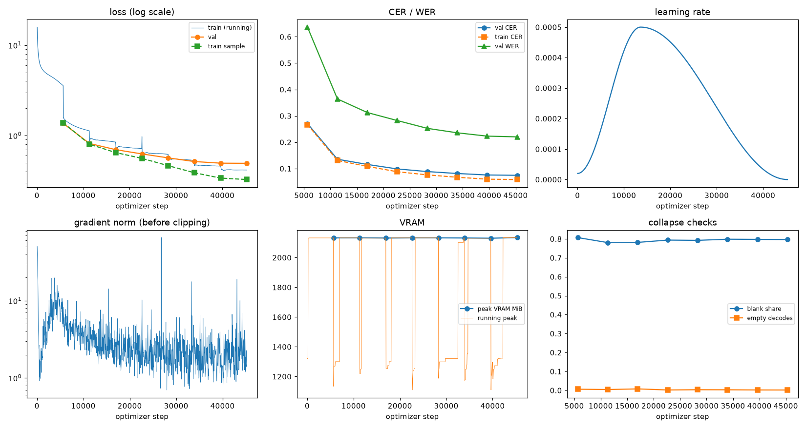
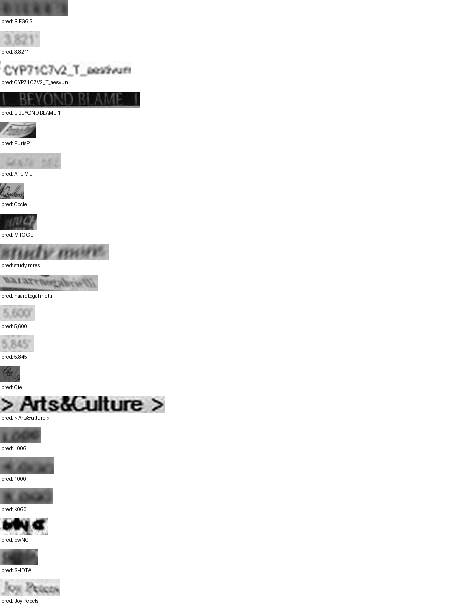

# Run report: GW-REC-031

Generated by `glypharis.training.report`; do not edit by hand.

## Run

- Config hash `1b6022e8567c07ca`, git `d75e3591a416383859e180d0429df3c8a6b41b96` (dirty: False)
- Device cuda (NVIDIA GeForce RTX 4050 Laptop GPU), precision bf16, torch 2.14.1+cu126
- Parameters 7,928,835 (30.2 MiB of weights and buffers); 348,935 training lines, 73,888 validation lines
- Epochs run 8, optimizer steps 45,298, stopped early: False; training time 5.34 h (5.34 GPU-hours)
- Data: `processed/hiertext/lines_train` 348,935 lines, sha256 b8cfff844ed2; `processed/hiertext/lines_validation` 73,888 lines, sha256 7db3ec6782ea

## Best and final epoch

| | Epoch | Step | Val CER % | Val WER % | Val loss | Train CER % |
|---|---|---|---|---|---|---|
| best (selected) | 7 | 45298 | 7.44 | 22.03 | 0.4925 | 5.84 |
| final | 7 | 45298 | 7.44 | 22.03 | 0.4925 | 5.84 |

The selected checkpoint is `best.pt`: the lowest validation CER (strict track), as the protocol requires (§7); the final epoch is shown for comparison.

Validation CER of the selected checkpoint: 7.44% [7.30, 7.60] (95% bootstrap CI over 73,888 lines).

## Notes

- Resumed from `last.pt` at step 33,975 (epoch 6).
- Resumed from `last.pt` at step 40,000 (epoch 7); 9 log records written after that checkpoint were moved to metrics.dropped.jsonl.

## Diagnostics

No flags raised.

## Curves

## Worst validation lines

| Key | Reference | Prediction | CER |
|---|---|---|---|
| bde51cd0a0e194b1/p34/l0 | s | BIEGGS | 6.00 |
| 03221b6a82a5a02e/p85/l0 | 3 | 3.821' | 5.00 |
| 1427a2dd12744f8f/p22/l2 | _T_ | CYP71C7V2_T_aesvun | 5.00 |
| 83265d4ad42b65eb/p21/l0 | \| \| | L BEYOND BLAME 1 | 5.00 |
| 902b8cf14489c26a/p18/l12 | P | PurtsP | 5.00 |
| 983a43804c520cc0/p13/l0 | L | ATE ML | 5.00 |
| da589d39cc2c3cea/p4/l1 | Q | Cocle | 5.00 |
| dcee27acd6d6883b/p0/l110 | C | MTO CE | 5.00 |
| e20fbc5878d56a36/p1/l40 | 5: | study mres | 5.00 |
| 76a7ad3fe918c4ef/p24/l0 | na/ | naaretogahrietli | 4.67 |
| 03221b6a82a5a02e/p84/l0 | 5 | 5,600 | 4.00 |
| 03221b6a82a5a02e/p86/l0 | 5 | 5,845 | 4.00 |
| 1177e2fd519784db/p0/l3 | W | Ctel | 4.00 |
| 50140f555f4d26d0/p32/l0 | > > | > Arts&ulture > | 4.00 |
| 75688de8882f42fa/p11/l0 | 1 | L00G | 4.00 |
| 75688de8882f42fa/p11/l1 | 4 | 1000 | 4.00 |
| 75688de8882f42fa/p11/l3 | 3 | K0G0 | 4.00 |
| bdd687b860d886a5/p2/l175 | A | bwNC | 4.00 |
| c624328101a5c91b/p9/l4 | S | SHDTA | 4.00 |
| ebca2758a3725a0a/p20/l30 | Pc | Joy Peocts | 4.00 |

