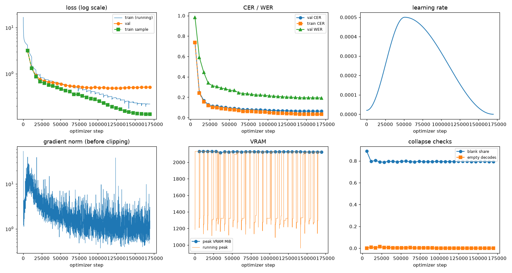
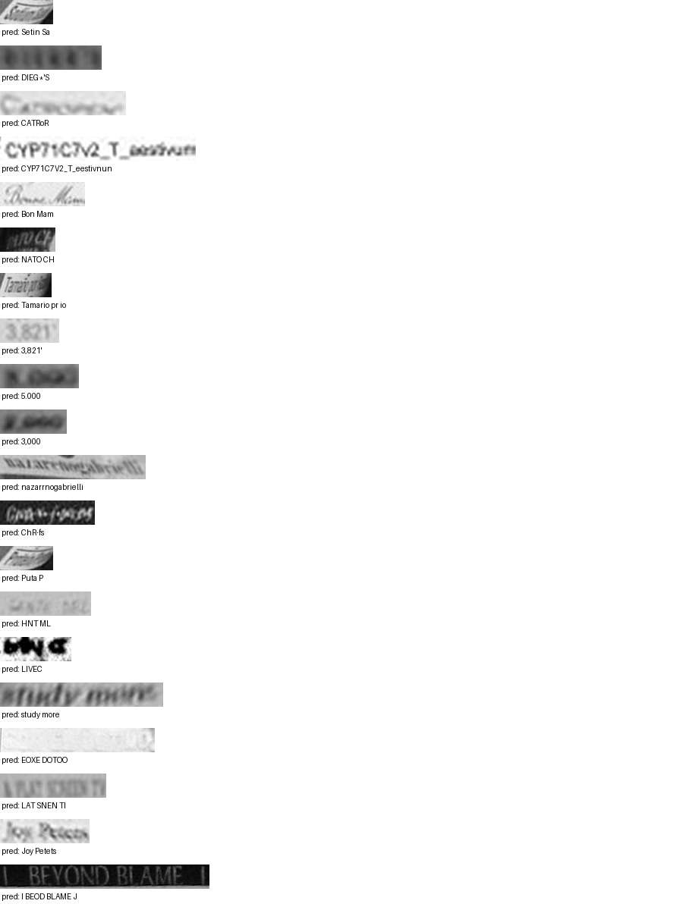

# Run report: GW-REC-034

Generated by `glypharis.training.report`; do not edit by hand.

## Run

- Config hash `488529a4e0c75b95`, git `d75e3591a416383859e180d0429df3c8a6b41b96` (dirty: False)
- Device cuda (NVIDIA GeForce RTX 4050 Laptop GPU), precision bf16, torch 2.14.1+cu126
- Parameters 7,928,835 (30.2 MiB of weights and buffers); 348,935 training lines, 73,888 validation lines
- Epochs run 30, optimizer steps 169,860, stopped early: False; training time 20.11 h (20.11 GPU-hours)
- Data: `processed/hiertext/lines_train` 348,935 lines, sha256 b8cfff844ed2; `processed/hiertext/lines_validation` 73,888 lines, sha256 7db3ec6782ea

## Best and final epoch

| | Epoch | Step | Val CER % | Val WER % | Val loss | Train CER % |
|---|---|---|---|---|---|---|
| best (selected) | 29 | 169860 | 6.30 | 19.37 | 0.5134 | 3.31 |
| final | 29 | 169860 | 6.30 | 19.37 | 0.5134 | 3.31 |

The selected checkpoint is `best.pt`: the lowest validation CER (strict track), as the protocol requires (§7); the final epoch is shown for comparison.

Validation CER of the selected checkpoint: 6.30% [6.17, 6.44] (95% bootstrap CI over 73,888 lines).

## Notes

- Resumed from `last.pt` at step 22,644 (epoch 4); 1 log records written after that checkpoint were moved to metrics.dropped.jsonl.
- Resumed from `last.pt` at step 31,000 (epoch 5); 4 log records written after that checkpoint were moved to metrics.dropped.jsonl.
- Resumed from `last.pt` at step 33,968 (epoch 6).
- Resumed from `last.pt` at step 142,000 (epoch 25); 18 log records written after that checkpoint were moved to metrics.dropped.jsonl.

## Diagnostics

No flags raised.

## Curves

## Worst validation lines

| Key | Reference | Prediction | CER |
|---|---|---|---|
| 902b8cf14489c26a/p18/l9 | S | Setin Sa | 7.00 |
| bde51cd0a0e194b1/p34/l0 | s | DIEG*'S | 7.00 |
| 013df9c6e5b5aed4/p0/l9 | G | CATRoR | 6.00 |
| 1427a2dd12744f8f/p22/l2 | _T_ | CYP71C7V2_T_eestivnun | 6.00 |
| 7d5f25d3c7f2eefa/p88/l0 | m | Bon Mam | 6.00 |
| dcee27acd6d6883b/p0/l110 | C | NATO CH | 6.00 |
| 902b8cf14489c26a/p19/l3 | Ta | Tamario pr io | 5.50 |
| 03221b6a82a5a02e/p85/l0 | 3 | 3,821' | 5.00 |
| 75688de8882f42fa/p11/l3 | 3 | 5.000 | 5.00 |
| 75688de8882f42fa/p11/l4 | 2 | 3,000 | 5.00 |
| 76a7ad3fe918c4ef/p24/l0 | na/ | nazarrnogabrielli | 5.00 |
| 8f80cc3eac928e4e/p22/l0 | C | ChR-fs | 5.00 |
| 902b8cf14489c26a/p18/l12 | P | Puta P | 5.00 |
| 983a43804c520cc0/p13/l0 | L | HNT ML | 5.00 |
| bdd687b860d886a5/p2/l175 | A | LIVEC | 5.00 |
| e20fbc5878d56a36/p1/l40 | 5: | study more | 5.00 |
| 154058472bd0c3bf/p21/l0 | ND | EOXE DOTOO | 4.50 |
| eb9c71f60af35ebe/p11/l4 | AT | LAT SNEN TI | 4.50 |
| ebca2758a3725a0a/p20/l30 | Pc | Joy Petets | 4.50 |
| 83265d4ad42b65eb/p21/l0 | \| \| | I BEOD BLAME J | 4.33 |

