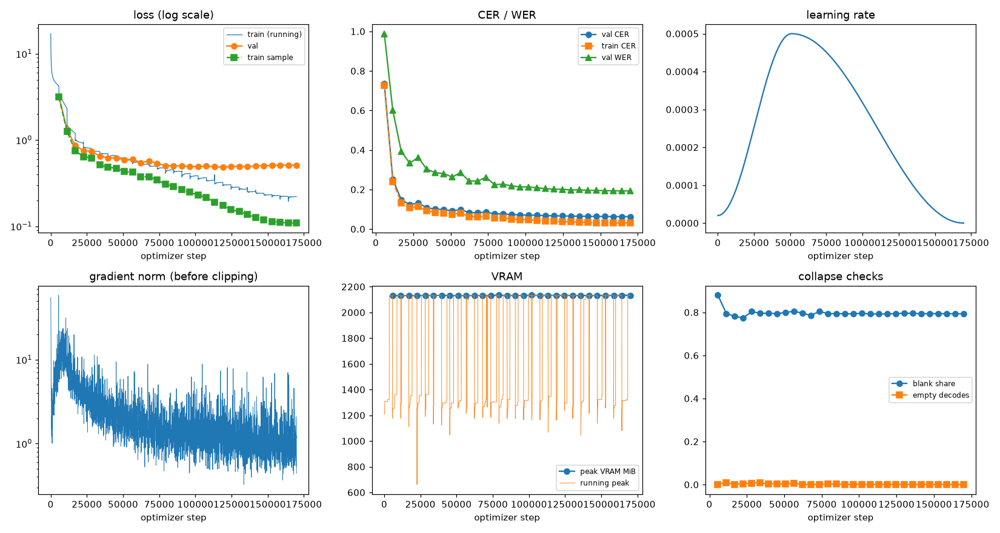
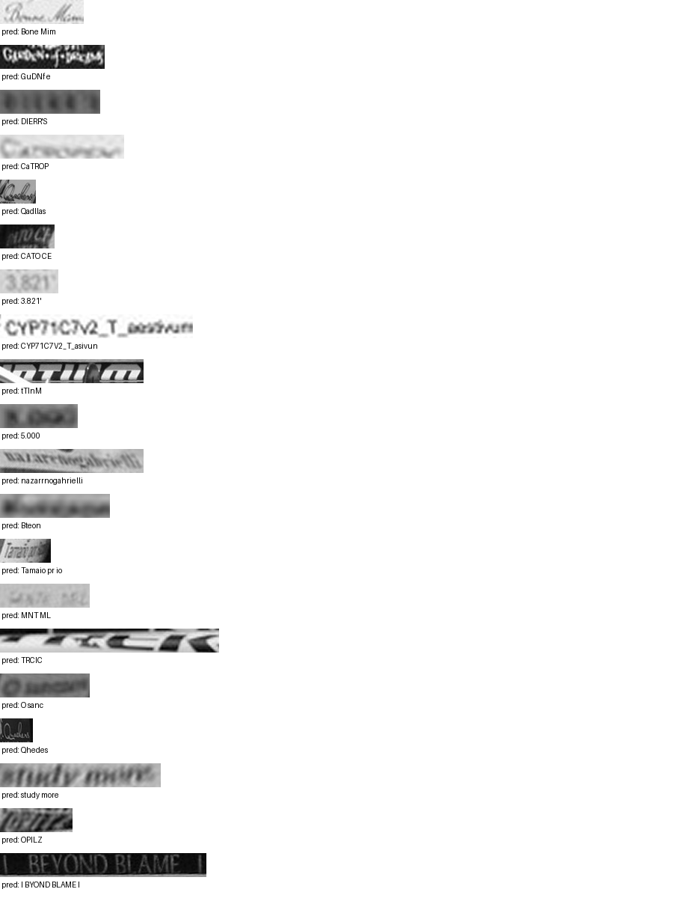

# Run report: GW-REC-035

Generated by `glypharis.training.report`; do not edit by hand.

## Run

- Config hash `11cf8858c8a4f57e`, git `d75e3591a416383859e180d0429df3c8a6b41b96` (dirty: False)
- Device cuda (NVIDIA GeForce RTX 4050 Laptop GPU), precision bf16, torch 2.14.1+cu126
- Parameters 7,928,835 (30.2 MiB of weights and buffers); 348,935 training lines, 73,888 validation lines
- Epochs run 30, optimizer steps 169,860, stopped early: False; training time 19.09 h (19.09 GPU-hours)
- Data: `processed/hiertext/lines_train` 348,935 lines, sha256 b8cfff844ed2; `processed/hiertext/lines_validation` 73,888 lines, sha256 7db3ec6782ea

## Best and final epoch

| | Epoch | Step | Val CER % | Val WER % | Val loss | Train CER % |
|---|---|---|---|---|---|---|
| best (selected) | 28 | 164197 | 6.28 | 19.26 | 0.5113 | 3.05 |
| final | 29 | 169860 | 6.28 | 19.28 | 0.5113 | 3.01 |

The selected checkpoint is `best.pt`: the lowest validation CER (strict track), as the protocol requires (§7); the final epoch is shown for comparison.

Validation CER of the selected checkpoint: 6.28% [6.15, 6.42] (95% bootstrap CI over 73,888 lines).

## Notes

- Resumed from `last.pt` at step 71,000 (epoch 12); 10 log records written after that checkpoint were moved to metrics.dropped.jsonl.
- Resumed from `last.pt` at step 147,214 (epoch 26).

## Diagnostics

No flags raised.

## Curves

## Worst validation lines

| Key | Reference | Prediction | CER |
|---|---|---|---|
| 7d5f25d3c7f2eefa/p88/l0 | m | Bone Mim | 7.00 |
| 8f80cc3eac928e4e/p21/l0 | C | GuDNf e | 7.00 |
| bde51cd0a0e194b1/p34/l0 | s | DIERR'S | 7.00 |
| 013df9c6e5b5aed4/p0/l9 | G | CaTROP | 6.00 |
| da589d39cc2c3cea/p4/l1 | Q | Qadllas | 6.00 |
| dcee27acd6d6883b/p0/l110 | C | CATO CE | 6.00 |
| 03221b6a82a5a02e/p85/l0 | 3 | 3.821' | 5.00 |
| 1427a2dd12744f8f/p22/l2 | _T_ | CYP71C7V2_T_asivun | 5.00 |
| 39fd7d18c550a0f2/p23/l0 | m | tTInM | 5.00 |
| 75688de8882f42fa/p11/l3 | 3 | 5.000 | 5.00 |
| 76a7ad3fe918c4ef/p24/l0 | na/ | nazarrnogahrielli | 5.00 |
| 88fc0fcb3a60f69e/p21/l0 | . | Bteon | 5.00 |
| 902b8cf14489c26a/p19/l3 | Ta | Tamaio pr io | 5.00 |
| 983a43804c520cc0/p13/l0 | L | MNT ML | 5.00 |
| a73ddc9ff0bbf3a0/p2/l71 | K | TRCIC | 5.00 |
| d6cffab23f5a1e4a/p60/l0 | O | O sanc | 5.00 |
| da589d39cc2c3cea/p3/l1 | Q | Qhedes | 5.00 |
| e20fbc5878d56a36/p1/l40 | 5: | study more | 5.00 |
| f1fa7e6c910f4ede/p1/l563 | M | OPILZ | 5.00 |
| 83265d4ad42b65eb/p21/l0 | \| \| | I BYOND BLAME I | 4.67 |

