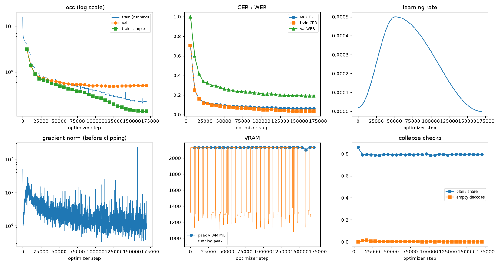
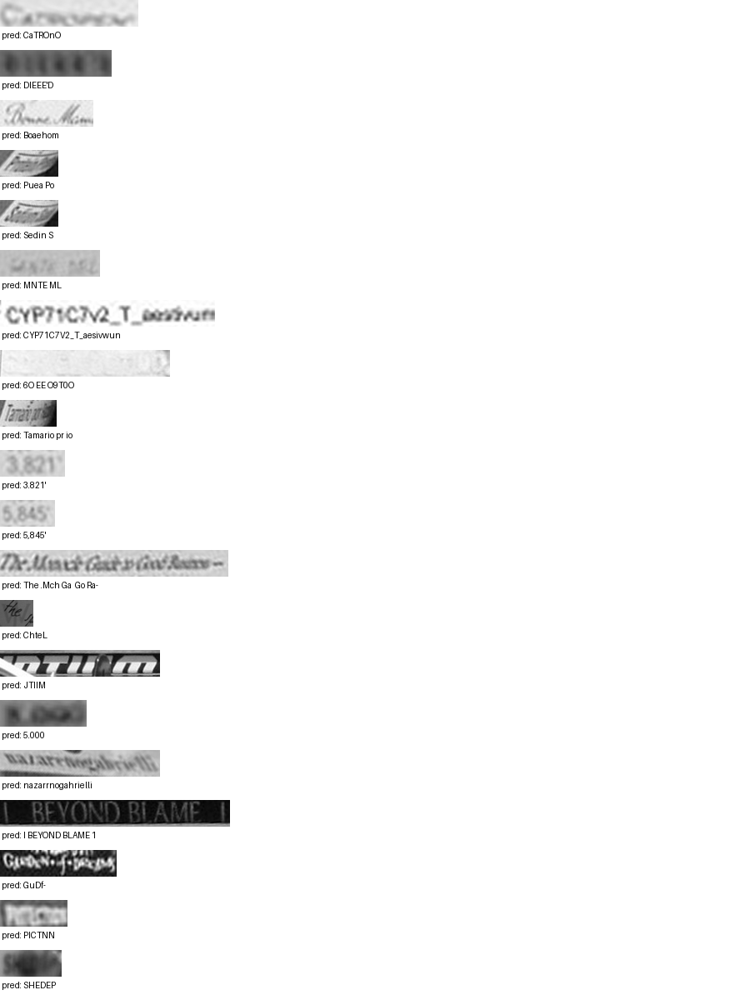

# Run report: GW-REC-036

Generated by `glypharis.training.report`; do not edit by hand.

## Run

- Config hash `67553639eccc2bd1`, git `d75e3591a416383859e180d0429df3c8a6b41b96` (dirty: False)
- Device cuda (NVIDIA GeForce RTX 4050 Laptop GPU), precision bf16, torch 2.14.1+cu126
- Parameters 7,928,835 (30.2 MiB of weights and buffers); 348,935 training lines, 73,888 validation lines
- Epochs run 30, optimizer steps 169,860, stopped early: False; training time 19.37 h (19.37 GPU-hours)
- Data: `processed/hiertext/lines_train` 348,935 lines, sha256 b8cfff844ed2; `processed/hiertext/lines_validation` 73,888 lines, sha256 7db3ec6782ea

## Best and final epoch

| | Epoch | Step | Val CER % | Val WER % | Val loss | Train CER % |
|---|---|---|---|---|---|---|
| best (selected) | 29 | 169860 | 6.30 | 19.24 | 0.5050 | 3.38 |
| final | 29 | 169860 | 6.30 | 19.24 | 0.5050 | 3.38 |

The selected checkpoint is `best.pt`: the lowest validation CER (strict track), as the protocol requires (§7); the final epoch is shown for comparison.

Validation CER of the selected checkpoint: 6.30% [6.17, 6.44] (95% bootstrap CI over 73,888 lines).

## Notes

- Resumed from `last.pt` at step 56,625 (epoch 10).

## Diagnostics

No flags raised.

## Curves

## Worst validation lines

| Key | Reference | Prediction | CER |
|---|---|---|---|
| 013df9c6e5b5aed4/p0/l9 | G | CaTROnO | 7.00 |
| bde51cd0a0e194b1/p34/l0 | s | DIEEE'D | 7.00 |
| 7d5f25d3c7f2eefa/p88/l0 | m | Boaehom | 6.00 |
| 902b8cf14489c26a/p18/l12 | P | Puea Po | 6.00 |
| 902b8cf14489c26a/p18/l9 | S | Sedin S | 6.00 |
| 983a43804c520cc0/p13/l0 | L | MNTE ML | 6.00 |
| 1427a2dd12744f8f/p22/l2 | _T_ | CYP71C7V2_T_aesivwun | 5.67 |
| 154058472bd0c3bf/p21/l0 | ND | 6O EE O9T0O | 5.50 |
| 902b8cf14489c26a/p19/l3 | Ta | Tamario pr io | 5.50 |
| 03221b6a82a5a02e/p85/l0 | 3 | 3.821' | 5.00 |
| 03221b6a82a5a02e/p86/l0 | 5 | 5,845' | 5.00 |
| 102f2c6a35f05df6/p5/l0 | The | The .Mch Ga  Go Ra- | 5.00 |
| 1177e2fd519784db/p0/l3 | W | ChteL | 5.00 |
| 39fd7d18c550a0f2/p23/l0 | m | JTIIM | 5.00 |
| 75688de8882f42fa/p11/l3 | 3 | 5.000 | 5.00 |
| 76a7ad3fe918c4ef/p24/l0 | na/ | nazarrnogahrielli | 5.00 |
| 83265d4ad42b65eb/p21/l0 | \| \| | I BEYOND BLAME 1 | 5.00 |
| 8f80cc3eac928e4e/p21/l0 | C | GuDf- | 5.00 |
| bd68198a86681f49/p22/l0 | P | PICTNN | 5.00 |
| c624328101a5c91b/p9/l4 | S | SHEDEP | 5.00 |

