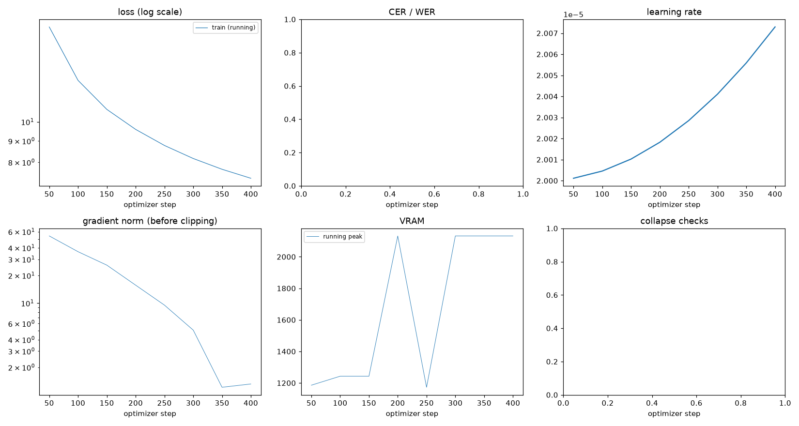

# Run report: GW-REC-046

Generated by `glypharis.training.report`; do not edit by hand.

## Run

- Config hash `1a6ea6ac342ad8db`, git `a457ad56b881c49333e66e16a06d930e7487a922` (dirty: False)
- Device cuda (NVIDIA GeForce RTX 4050 Laptop GPU), precision bf16, torch 2.14.1+cu126
- Parameters 7,928,835 (30.2 MiB of weights and buffers); 348,935 training lines, 73,888 validation lines
- Epochs run 0, optimizer steps 400, stopped early: False; training time 0.06 h (0.06 GPU-hours)
- Data: `processed/hiertext/lines_train` 348,935 lines, sha256 b8cfff844ed2; `processed/hiertext/lines_validation` 73,888 lines, sha256 7db3ec6782ea

## Best and final epoch

| | Epoch | Step | Val CER % | Val WER % | Val loss | Train CER % |
|---|---|---|---|---|---|---|
| best (selected) | - | - | - | - | - | - |
| final | - | - | - | - | - | - |

The selected checkpoint is `best.pt`: the lowest validation CER (strict track), as the protocol requires (§7); the final epoch is shown for comparison.

## Notes

- Resumed from `last.pt` at step 200 (epoch 0).

## Diagnostics

No flags raised.

## Curves

## Worst validation lines

The lines and crops in this section come from HierText validation (Long et al., CVPR 2022), released under CC BY-SA 4.0, and are shared here under the same licence. The images come from Open Images, which lists them as CC BY 2.0 and does not warrant the licence of each image. See `DATASETS.md`.

| Key | Reference | Prediction | CER |
|---|---|---|---|
