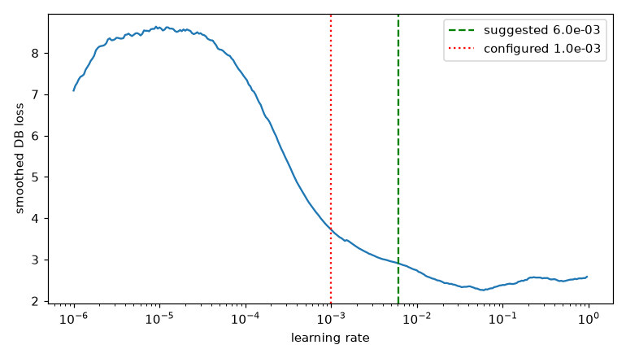

# Sanity sequence: GW-DET-001

Generated by `scripts/det_sanity.py`; do not edit by hand.

Device cuda, precision bf16, git `03eb2ac63192826ab95668f03e3410b624491bfe`.

- **Label ceiling** (1,715 validation pages at 1280 px): selection ceiling F1@0.5 0.9481 at `inverse10` (gate 0.9), representational 0.9916, poly 0.9484; demoted care lines 9.1%; counting mismatches 0: PASS
- **Overfit one batch** (8 crops): kernel Dice 0.973, threshold L1 0.0181, F1@0.5 0.944 against a batch ceiling of 0.990 after 600 steps: PASS
- **LR range test**: lowest smoothed loss at 6.03e-02; suggested 6.03e-03, configured 1.00e-03 (outside 3x). 
- **Dry run** (10.0 min): 45.95 crops/s, 174.1 ms/step, data wait 2%, peak reserved VRAM 2.57421875 GiB (train) / 2.57421875 GiB (validation), RSS 8.13 GB, GPU max 60 C, loss finite: True; about 11.9 min per epoch, validation 36% of it, 24 epochs by the 9-hour rule, 6.47 GPU-hours at the configured epochs: FAIL
- **Resume check** (two uninterrupted runs A, B; C resumed from B's checkpoint at step 151 of 300, mid-epoch: True): first step after the resume differs by 0.00e+00 (tolerance 1e-06); learning rates identical: True; largest relative loss difference C vs B 0.00e+00, A vs B 0.00e+00 (allowed 1.00e-04); largest relative weight difference C vs B 0.00e+00, A vs B 0.00e+00; val_f1_50 history equal: True: PASS
