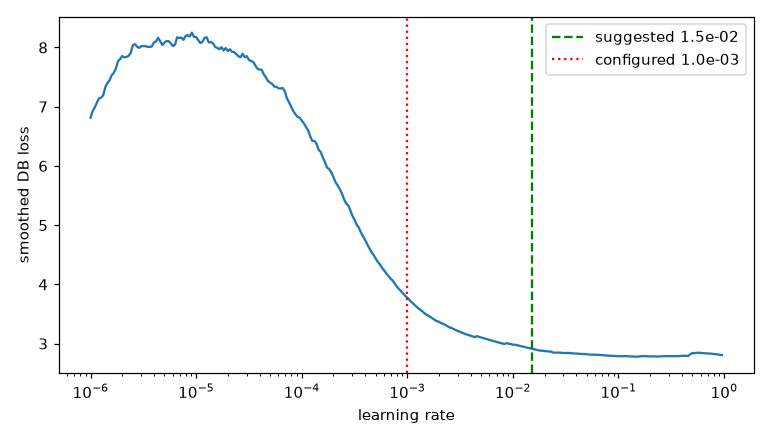

# Sanity sequence: GW-DET-002

Generated by `scripts/det_sanity.py`; do not edit by hand.

Device cuda, precision bf16, git `03eb2ac63192826ab95668f03e3410b624491bfe`.

- **LR range test**: lowest smoothed loss at 1.51e-01; suggested 1.51e-02, configured 1.00e-03 (outside 3x). 
- **Dry run** (10.0 min): 46.06 crops/s, 173.7 ms/step, data wait 2%, peak reserved VRAM 2.57421875 GiB (train) / 2.57421875 GiB (validation), RSS 7.24 GB, GPU max 60 C, loss finite: True; about 11.9 min per epoch, validation 32% of it, 24 epochs by the 9-hour rule, 6.29 GPU-hours at the configured epochs: FAIL
