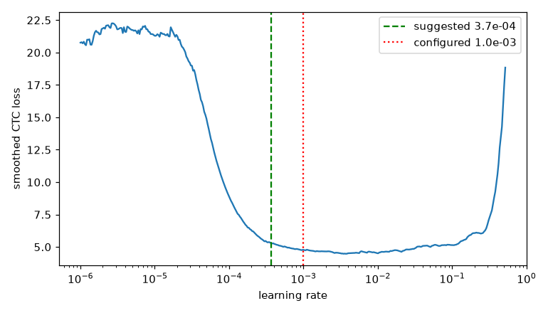

# Sanity sequence: GW-REC-001

Generated by `scripts/rec_sanity.py`; do not edit by hand.

Device cuda, precision bf16, git `2881206c5b16639c7abd365d51f51dcd8b41c296`.

- **Overfit 64 lines**: CER 0.39% after 450 steps (target <= 1%): PASS
- **LR range test**: lowest smoothed loss at 3.72e-03; suggested 3.72e-04, configured 1.00e-03 (within 3x). 
- **Dry run** (10.0 min): 619.9 lines/s, 99.3 ms/step, data wait 6%, peak VRAM 3825.5 MiB, GPU max 61 C, loss finite: True; about 9.4 min per epoch
- **Resume check**: stopped at step 201 of 400 (mid-epoch: True), resumed; largest relative loss difference 2.01e-02 over 400 steps (tolerance 0.0001), largest relative weight difference 1.09e+00: FAIL
- **Resume check** (two uninterrupted runs A, B; C resumed from B's checkpoint at step 201 of 400, mid-epoch: True): first step after the resume differs by 0.00e+00 (tolerance 1e-06); learning rates identical: True; largest relative loss difference C vs B 1.51e-02, A vs B 2.90e-02 (allowed 5.80e-02); largest relative weight difference C vs B 9.72e-01, A vs B 7.37e-01: PASS
