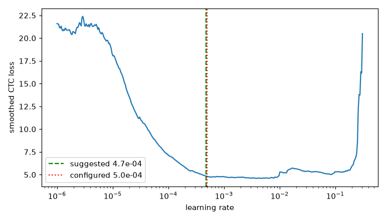

# Sanity sequence: GW-REC-020

Generated by `scripts/rec_sanity.py`; do not edit by hand.

Device cuda, precision bf16, git `6dbacf043f587b6253b9047a314043fa39b577e1`.

- **Overfit 64 lines**: CER 0.00% after 300 steps (target <= 1%): PASS
- **LR range test**: lowest smoothed loss at 4.73e-03; suggested 4.73e-04, configured 5.00e-04 (within 3x). 
- **Dry run** (10.0 min): 191.9 lines/s, 80.2 ms/step, data wait 0%, peak VRAM 2734.3 MiB, GPU max 56 C, loss finite: True; about 30.3 min per epoch
